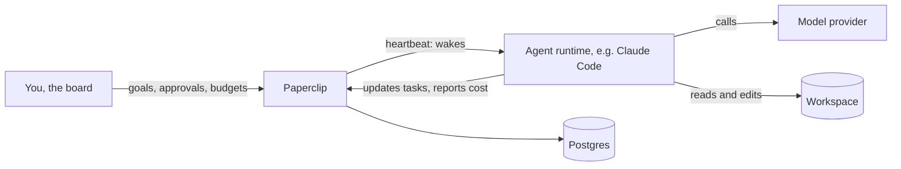

# AI Agents on a Server

An AI agent left running on a server is a program that spends money, runs commands
and acts on what it reads, often while nobody is watching. So you need more than a
way to start it: you need to see what it did, cap what it costs, and stop it.

This section uses [Paperclip](https://github.com/paperclipai/paperclip), an
MIT-licensed, self-hosted control plane for agents. Paperclip doesn't contain a
model and isn't an agent itself. It runs agent tools such as Claude Code or Codex,
and adds the task board, schedules, budgets and approvals around them.

## The concepts

| Concept | What it is |
| --- | --- |
| Company | The top-level container for one goal, with its own agents, tasks and budgets. One server can host several |
| Board | You, the human with the final say |
| Agent | A worker with a role, a manager, instructions and a budget. The first one in a company is always the CEO |
| Adapter | The connector to an agent tool, such as `claude_local` or `codex_local` |
| Heartbeat | One wake-up, in which an agent runs and does some work |
| Routine | A scheduled or webhook-triggered job that creates a task for an agent |
| Approval | A decision waiting for you, such as a strategy or a new hire |
| Budget | A monthly spending limit that pauses agents when it's reached |

## What's covered

| Page | Focus |
| --- | --- |
| [Installing Paperclip](./paperclip-install) | Choosing a mode, Docker Compose, claiming the instance, HTTPS, and the npm alternative. |
| [Private Access with Tailscale](./paperclip-tailscale) | The recommended setup: an HTTPS address only your devices can reach, a tailnet policy that contains the server, and a closed firewall. |
| [Working with Agents](./paperclip-agents) | Your first company and agent, tasks, instructions, hiring, schedules and workspaces. |
| [Managing Agents](./paperclip-operations) | Budgets, stopping agents, security limits, secrets, backups, updates and troubleshooting. |
| [Cheat Sheet](./cheatsheet) | One-line reminders grouped by task. |

## Is this right for you?

Paperclip suits long-running work split between several agents, where you want a
record of what happened and a limit on what it costs.

- **One coding task, with you watching?** Run the agent tool directly. Paperclip
  adds a database and a dashboard you don't need.
- **One script on a schedule?** Use cron or a CI schedule with a single agent
  command.
- **Agents that handle untrusted input and hold valuable credentials?** Read
  [what the permissions don't protect](./paperclip-operations#what-the-permissions-don-t-protect)
  first, because Paperclip's controls don't isolate agents on this setup.

## How this guide is checked

Paperclip changes quickly, and this guide was checked against **v2026.1023.0**.
Check the [official docs](https://docs.paperclip.ing) when a detail doesn't match
what you see.

The Compose file is a real example under
[`examples/servers/paperclip`](https://github.com/jgteske/best-practices-repo/tree/main/examples/servers/paperclip),
and `npm run check:servers` validates it.

::: warning What was and wasn't run
The Compose stack was started once on a local machine. That run covered the health
check, claiming the instance, setting a budget, a backup, restoring it into an empty
database, and a test agent running a shell command.

It did not cover an agent using a real model, a real tailnet, the Caddy setup, public
mode, the npm install, or updating between versions. Those steps come from the
Paperclip and Tailscale docs.
:::
