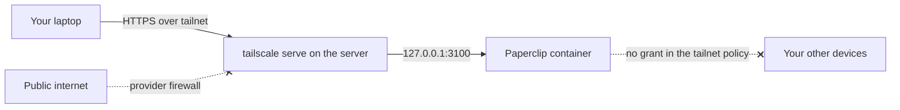

# Private Access with Tailscale

This is the recommended way to reach Paperclip: nothing listens on the public
internet, and only devices you allow get to the login page. Tailscale handles the
HTTPS certificate, so you don't need a domain or a reverse proxy.



The commands below follow Tailscale's docs for
[Serve](https://tailscale.com/kb/1242/tailscale-serve),
[HTTPS certificates](https://tailscale.com/kb/1153/enabling-https) and
[auth keys](https://tailscale.com/kb/1085/auth-keys).

## 1. Prepare the tailnet

In the [admin console](https://login.tailscale.com/admin/dns), enable **MagicDNS**
and **HTTPS Certificates**.

Certificates go into public transparency logs that anyone can search, so **the
machine name becomes public**. Your tailnet name is published too. Use a plain name
like `paperclip`, not a client or project name.

## 2. Limit what the server can reach

[Agents aren't isolated](./paperclip-operations#what-the-permissions-don-t-protect)
from the machine they run on, and joining a tailnet puts that machine next to your
other devices. Treat it as untrusted: tag it, then allow traffic to it but not from it.

Edit the [tailnet policy](https://login.tailscale.com/admin/acls), using your own
address:

```json
{
  "groups": {
    "group:paperclip-admins": ["you@example.com"]
  },
  "tagOwners": {
    "tag:paperclip": ["group:paperclip-admins"]
  },
  "grants": [
    {
      "src": ["group:paperclip-admins"],
      "dst": ["tag:paperclip"],
      "ip": ["tcp:443", "tcp:22"]
    }
  ]
}
```

- **Merge this into your existing policy** instead of replacing it, and keep the
  rules your other devices need.
- **Check for an allow-all rule.** Tailscale denies whatever isn't granted, but a rule
  with `*` as source and destination grants everything, including this server's
  access to your other devices. Narrow it so that `tag:paperclip` isn't a source.
- **Never add `tag:paperclip` as a `src`** unless an agent really needs that one
  service.

Check the result with the policy editor's preview before you save it.

## 3. Join the server

Create an [auth key](https://login.tailscale.com/admin/settings/keys) that is
one-off, not ephemeral, and has the tag `tag:paperclip`. Then, on the server:

```bash
curl -fsSL https://tailscale.com/install.sh | sudo sh
sudo tailscale up --auth-key="$TS_AUTH_KEY" --hostname=paperclip
tailscale status
```

- **Run this on the host, not in a container,** so it's outside what agents' Docker
  volumes and environment contain.
- **Tagged devices don't need re-authenticating,** because key expiry is off for them
  by default. The auth key itself isn't needed after this.
- **Don't put the key in `.env`.** Agents can read what the
  [server's process can read](./paperclip-operations#what-the-permissions-don-t-protect).

## 4. Point Paperclip at its address

The address is `https://paperclip.<your-tailnet>.ts.net`. Set it in `.env` from
[the install page](./paperclip-install#start-it-with-docker-compose), then start or
restart the stack:

```bash
tailscale status --json | jq -r .Self.DNSName    # paperclip.your-tailnet.ts.net.

# in .env, with no trailing dot
PAPERCLIP_PUBLIC_URL=https://paperclip.your-tailnet.ts.net

docker compose up -d
```

You don't need `PAPERCLIP_ALLOWED_HOSTNAMES`, because Paperclip accepts the hostname
in `PAPERCLIP_PUBLIC_URL`. Other hostnames get a `403`.

## 5. Turn on HTTPS

```bash
sudo tailscale serve --bg 3100
tailscale serve status
```

`--bg` keeps it running across reboots until you turn it off. Tailscale gets and
renews the certificate, and forwards requests to `127.0.0.1:3100`.

Use `serve`, **not `funnel`**. Funnel publishes the service to the internet.

## 6. Claim the instance and check it

From a device on the tailnet:

```bash
curl -s https://paperclip.your-tailnet.ts.net/api/health
```

Open the address in a browser, create an account and choose
[**Claim this instance**](./paperclip-install#claim-the-instance-straight-away).
**Always sign in through this address.** The session cookie is marked `Secure`, so
logging in over plain HTTP, such as an SSH tunnel to port 3100, won't keep you signed
in.

## 7. Close the public side

Once you can reach SSH and Paperclip over the tailnet:

1. Connect with `ssh you@paperclip`, using the tailnet name.
2. Remove the HTTP and HTTPS rules from the
   [Terraform firewall](../servers/terraform). This server doesn't need them.
3. Restrict or remove the public SSH rule. First
   [test your provider's web console](../servers/your-own-server#checklist), since
   that's your way in if Tailscale fails.
4. **From a device outside the tailnet**, confirm that nothing answers:

```bash
nmap -Pn -p 22,80,443,3100 <public-ip>    # want: filtered or closed
```

Tailscale connects outward, so it keeps working with no inbound rules.

## Webhooks and connectors

A private address can't receive calls from outside services, so GitHub webhooks and
similar callbacks won't arrive. Things you trigger from inside still work, including
scheduled routines and agents calling out to providers.

If you need inbound webhooks, Paperclip's
[HTTPS guide](https://docs.paperclip.ing/reference/deploy/https/) describes using
Funnel on a separate port with `PAPERCLIP_CHAT_WEBHOOK_PUBLIC_URL`. Funnel exposes
every route on that port and has a different risk profile, so read it closely, and
consider polling instead.

## If something goes wrong

| Symptom | Check |
| --- | --- |
| `serve` asks you to enable HTTPS | Enable HTTPS Certificates in the admin console (step 1) |
| Name doesn't resolve | MagicDNS is on, and Tailscale is connected on your device |
| Times out from your device | Your account is in `group:paperclip-admins`, and the server is tagged |
| `403` about the hostname | `PAPERCLIP_PUBLIC_URL` doesn't match the address you're using |
| Login doesn't stick | You're not on the `https://....ts.net` address |
| `502` from Tailscale | Paperclip isn't up: `docker compose ps` and `docker compose logs paperclip` |
| Tailscale itself is down | Use the provider's web console. `docker compose stop paperclip` still stops all agents |

To remove the route, run `sudo tailscale serve reset`.

## Rules of thumb

- Tag the server, and never use the tag as a source in a grant.
- Use `serve`, not `funnel`, and keep port 3100 on loopback.
- Keep machine names free of anything sensitive.
- Test from outside the tailnet after closing the firewall.
- Keep a way in that doesn't depend on Tailscale.

::: warning How this was checked
No real tailnet was used. A local stack was sent requests carrying the `.ts.net`
host and origin, which covered the hostname check, signing up and claiming the
instance. The Tailscale commands, policy and firewall steps come from Tailscale's docs
and haven't been run, so test them on a disposable server first.
:::
