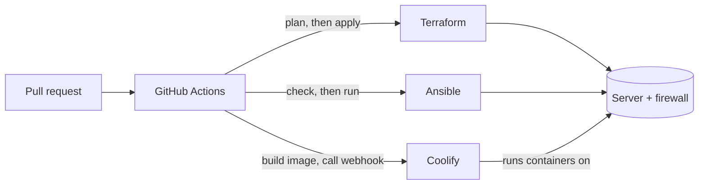

# Servers with Terraform, Ansible & Coolify

A server you set up by hand works until the day you need to rebuild it and
nobody remembers how. This section keeps the whole setup in Git, so you can
review a change before it happens and recreate the server from an empty account.
It uses three tools, and the main practice is to keep each one in its own layer.

| Layer | Tool | Owns | Typical change |
| --- | --- | --- | --- |
| Infrastructure | Terraform or OpenTofu | Servers, firewalls, volumes, DNS | Resize the server, open a port |
| Operating system | Ansible | Users, SSH, patching, base packages | Add an admin key, harden SSH |
| Applications | Coolify | Apps, databases, reverse proxy, TLS | Deploy an app, schedule a database backup |
| Pipeline | GitHub Actions | Running all of the above | Merge a pull request |

## Rules that keep the layers clean

- **One owner for each setting.** If Ansible and a person in a dashboard both
  manage the same thing, one will silently overwrite the other. Open firewall
  ports in Terraform only, never by hand in the provider's console.
- **Cloud-init only bootstraps.** It runs once, so it does the minimum Ansible
  needs. Everything else goes in a role that can run again.
- **Ansible stops at the OS.** Coolify installs Docker and manages the
  containers on the server, so don't manage those with Ansible as well.
- **Know what isn't in Git.** Coolify keeps its projects and settings in its own
  database. That's why [backups](./operations#backups) and written-down settings
  matter even with everything else automated.
- **Secrets stay out of the repository in plain text.** Use CI secrets, Ansible
  Vault and Coolify's environment variables.

## What's covered

| Page | Focus |
| --- | --- |
| [Terraform](./terraform) | Project layout, remote state, the firewall, and protecting a server from accidental replacement. |
| [Ansible](./ansible) | Roles, idempotence, SSH hardening without a lockout, automatic patching, and Vault. |
| [Coolify](./coolify) | Installing it, closing setup ports, choosing a build method, and what it needs from the host. |
| [Docker Setups](./docker) | Small non-root images, Compose with healthchecks and limits, networks, volumes, and the UFW trap. |
| [Automating with CI/CD](./automation) | A pipeline for each layer, credentials, drift detection, and rollback. |
| [Day-to-Day Operations](./operations) | Patching, monitoring, disk, access, and backups with restore drills. |
| [Running Your Own Server](./your-own-server) | The whole setup from an empty account, and how to rebuild after losing the server. |
| [Cheat Sheet](./cheatsheet) | One-line reminders grouped by task. |

## Is this stack right for you?

It fits one to a handful of servers running your own apps, where a managed
platform costs too much or restricts too much. Be honest about the trade: you
take on patching, backups and being the person who gets paged.

- **One app and little time?** A managed platform is less work.
- **One personal server?** Coolify plus the Ansible hardening alone gets you most
  of the benefit. Add Terraform when you want to recreate the server from code.
- **Many servers, strict uptime targets, or autoscaling?** You'll outgrow this.
  A single Coolify server is also a single point of failure.

## How these examples are checked

The samples are real files under
[`examples/servers`](https://github.com/jgteske/best-practices-repo/tree/main/examples/servers),
and `npm run check:servers` checks them: `tofu validate`, `ansible-lint`, an
Ansible syntax check, `docker compose config` and a real `docker build`. The
workflows are linted with actionlint.

::: warning Validated, not run against a real server
These checks catch invalid configuration. They don't apply anything to a cloud
account or a server, so try the playbooks on a disposable server first. Hetzner
is the example provider, but the structure carries over to any provider with a
Terraform provider and a network firewall.
:::
